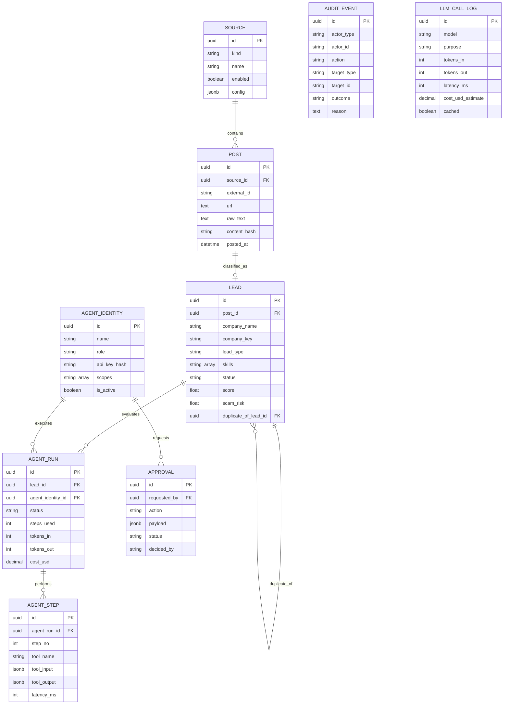

# Hiring Radar

Agent-native platform that finds hiring and freelance-gig signals on public sources, qualifies each lead with a tool-using AI agent, and provides a ranked lead feed for recruiters and agencies.

## Target Niche
Python, Backend, and GenAI developer roles, internships, and freelance gigs (India + Remote).

## Tech Stack
- **Backend**: Python 3.12, FastAPI, Pydantic v2, SQLAlchemy 2.x, psycopg v3, structlog, httpx
- **Database**: PostgreSQL 16 (plain image, no pgvector)
- **Agent Framework**: LangChain, LangGraph (with Google Gemini API on free tier)
- **Tooling**: Docker Compose, pytest, ruff, make

## Prerequisites
- Docker & Docker Compose
- Python 3.12+ (for local host development)

## Quick Start (Docker Compose)

1. Copy the example environment configuration:
   ```bash
   cp .env.example .env
   ```
2. Start the services:
   ```bash
   make up
   ```
3. Check the health endpoint:
   ```bash
   curl http://localhost:8000/api/health
   ```
4. Stop the services:
   ```bash
   make down
   ```

## Local Development

1. Create and activate a virtual environment:
   ```bash
   python3 -m venv backend/.venv
   source backend/.venv/bin/activate
   ```
2. Install the backend package and development dependencies:
   ```bash
   cd backend && pip install -e ".[dev]"
   ```
3. Run tests and linters:
   ```bash
   make lint
   make test
   ```

## Data Model

The database is built on PostgreSQL 16 using SQLAlchemy 2.x declarative models and managed with Alembic migrations (`backend/migrations/`).



> [!NOTE]
> `audit_event` is strictly append-only. A PostgreSQL trigger function (`trg_audit_event_append_only`) raises an exception on any `UPDATE` or `DELETE` attempt.
