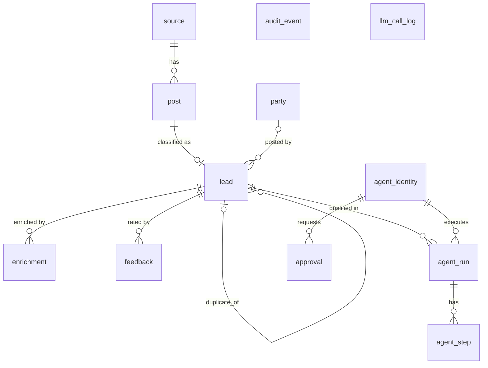

# Hiring Radar

Finds hiring and freelance-gig signals on public sources, qualifies each lead with a tool-using AI agent, and shows a ranked lead feed. The dashboard and AI agents use the same typed API.

Initial niche: Python / backend / GenAI roles, internships and freelance gigs (India + remote).

> Status: skeleton only (step 1). See `PROGRESS.md` and `specs/`.

## Run

```bash
cp .env.example .env     # optional for compose; compose sets its own env
make up                  # postgres + redis + api (hot reload)
curl localhost:8000/api/health
make logs
make down
```

If you only have the legacy `docker-compose` binary (v1), add `COMPOSE=docker-compose`, e.g. `make up COMPOSE=docker-compose`.
Host ports: postgres `5434`, redis `6380`, api `8000` (override via `POSTGRES_HOST_PORT` / `REDIS_HOST_PORT`).

## Test

```bash
python3.12 -m venv backend/.venv
backend/.venv/bin/pip install -r backend/requirements-dev.txt
make db-up redis-up   # tests need the compose Postgres + Redis (throwaway <db>_test database)
make test      # pytest
make lint      # ruff check + format check
make fmt       # auto-fix
```

## Collectors

Allowed sources only: Hacker News "Who is hiring?" (Algolia API), Reddit (official API via PRAW), RSS/Atom feeds. No scraping of
LinkedIn/Instagram/X ([ADR 0001](docs/adr/0001-no-social-scraping.md)); for those, paste a post via `POST /api/captures` or import a
CSV via `POST /api/captures/csv`.

```bash
cd backend
.venv/bin/python -m app.jobs.ingest --source hn            # fetch + store (incremental)
.venv/bin/python -m app.jobs.ingest --source hn --full     # re-read everything; second run inserts 0
.venv/bin/python -m app.jobs.ingest --source rss --feed https://example.com/jobs.xml
make up COMPOSE=docker-compose                              # also starts a Celery worker + beat (every INGEST_INTERVAL_HOURS)
```

Reddit needs `REDDIT_CLIENT_ID` / `REDDIT_CLIENT_SECRET` (read-only app, https://www.reddit.com/prefs/apps) in `.env`.

## LLM gateway

All model access goes through `LLMClient` (`backend/app/llm/`); business code never imports a provider SDK.
Build one with `app.llm.factory.build_llm_client(...)`. Tests use `FakeLLMClient`; CI never calls the network.

Live check with a real key (free tier): put `GEMINI_API_KEY` in `.env`, then
`make migrate && cd backend && .venv/bin/pytest -m live -s`. Check your free-tier limit in
[Google AI Studio](https://aistudio.google.com/rate-limit) and set `LLM_RPM_LIMIT` accordingly.

## Data model

Migrations: `make migrate` (`alembic upgrade head`); `alembic downgrade base` undoes everything.
`audit_event` is append-only: a database trigger rejects UPDATE, DELETE and TRUNCATE.



`audit_event` and `llm_call_log` have no foreign keys on purpose: they are logs that must outlive the rows they describe.
