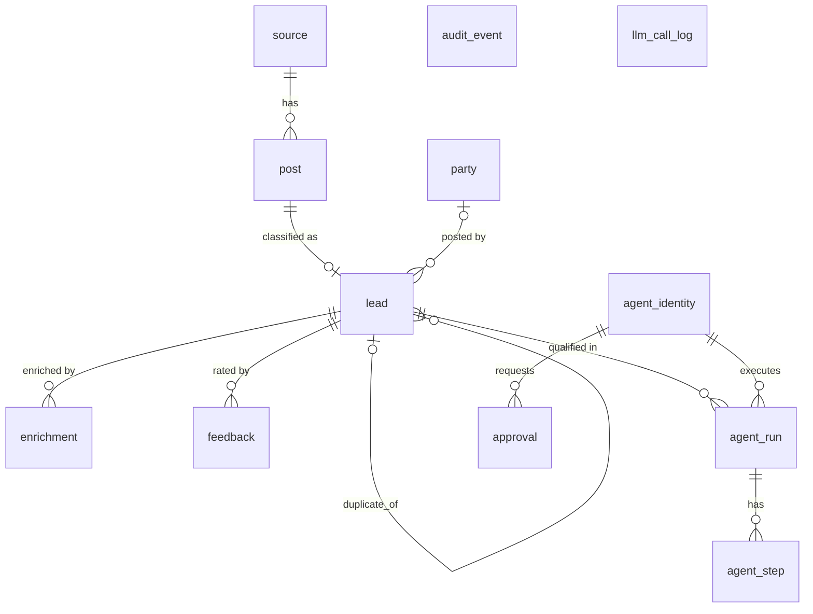

# Hiring Radar

Finds hiring and freelance-gig signals on public sources, qualifies each lead with a tool-using AI agent, and shows a ranked lead feed. The dashboard and AI agents use the same typed API.

Initial niche: Python / backend / GenAI roles, internships and freelance gigs (India + remote).

> Status: skeleton only (step 1). See `PROGRESS.md` and `specs/`.

## Run

```bash
cp .env.example .env     # optional for compose; compose sets its own env
make up                  # postgres + redis + api (hot reload)
curl localhost:8000/api/health
make logs
make down
```

If you only have the legacy `docker-compose` binary (v1), add `COMPOSE=docker-compose`, e.g. `make up COMPOSE=docker-compose`.
Host ports: postgres `5434`, redis `6380`, api `8000` (override via `POSTGRES_HOST_PORT` / `REDIS_HOST_PORT`).

## Test

```bash
python3.12 -m venv backend/.venv
backend/.venv/bin/pip install -r backend/requirements-dev.txt
make db-up     # tests need the compose Postgres (uses a throwaway <db>_test database)
make test      # pytest
make lint      # ruff check + format check
make fmt       # auto-fix
```

## Data model

Migrations: `make migrate` (`alembic upgrade head`); `alembic downgrade base` undoes everything.
`audit_event` is append-only: a database trigger rejects UPDATE, DELETE and TRUNCATE.



`audit_event` and `llm_call_log` have no foreign keys on purpose: they are logs that must outlive the rows they describe.
